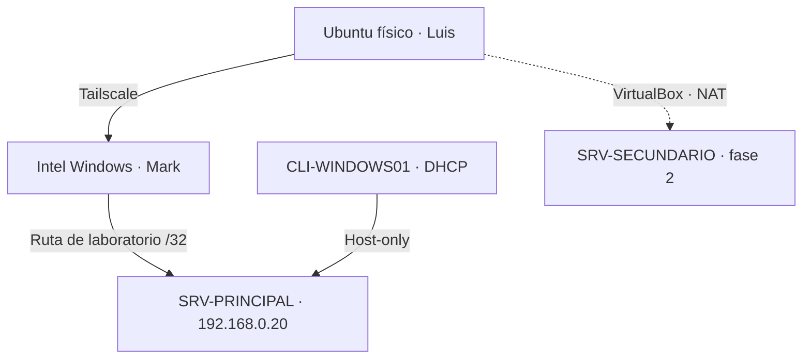
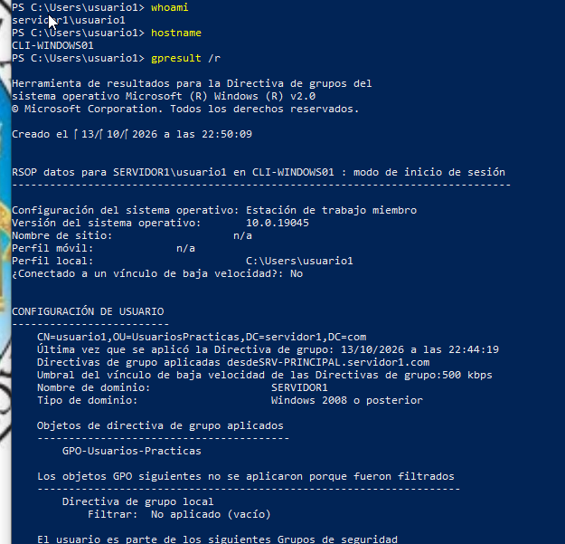
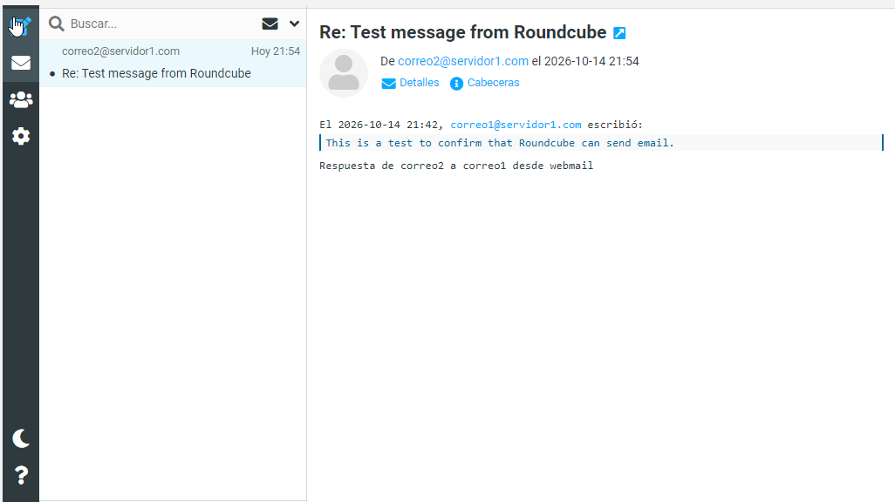

# Proyecto final · Prácticas Iniciales 2026

**Universidad de San Carlos de Guatemala · Facultad de Ingeniería · Escuela de Práctica Supervisada · Sección F**

Implementación de un laboratorio de servicios de red con Windows Server, un cliente Windows y acceso desde Ubuntu. Este repositorio reúne el manual técnico, las evidencias y las pruebas del equipo.

**Integrantes documentados:** Marco David Mérida Velásquez (202500065) y Luis Saloj. Completar los demás datos académicos que correspondan antes de la entrega.

> **Estado de avance al 15 de octubre de 2026, hora de Guatemala:** los servicios principales de la fase 1 funcionan desde Windows. Ubuntu ya accede al correo web por Tailscale; su unión al dominio está bloqueada por cifrado Kerberos y las pruebas restantes siguen pendientes. Esta documentación no declara la fase 1 completamente finalizada.

## Entregas

| Fase | Puntos del enunciado | Fecha |
|---|---|---|
| 1 | 1, 2, 3, 4, 6 y 8 | 15/10/2026 |
| 2 | 5, 7, 9 y 10, integrados con fase 1 | 29/10/2026 |

La impresora compartida del punto 3 se evalúa en la fase 2, según la nota del enunciado.

## Navegación

- [Arquitectura, equipos y direccionamiento](docs/01-arquitectura.md)
- [Manual de configuración de la fase 1](docs/02-manual-fase1.md)
- [Plan de pruebas y estado por requisito](docs/03-pruebas-y-pendientes.md)
- [Conexión remota y preparación de Ubuntu](docs/04-tailscale-ubuntu.md)
- [Incidencias resueltas y diagnóstico pendiente](docs/05-incidencias.md)
- [Galería de 22 evidencias](evidencias/README.md)
- [Referencias técnicas](docs/06-referencias.md)
- [Diagnóstico Windows, solo lectura](scripts/windows/Diagnostico-Fase1.ps1)
- [Diagnóstico Ubuntu, solo lectura](scripts/ubuntu/diagnostico.sh)

## Servicios implementados

| Punto | Implementación | Estado comprobado |
|---|---|---|
| 1. Virtualización | VirtualBox; SRV-PRINCIPAL y CLI-WINDOWS01 en Intel; SRV-SECUNDARIO en equipo de Luis | Revisar requisito de cliente virtual en segundo HOST |
| 2. Usuarios | AD DS, DNS, DHCP y GPO en `servidor1.com` | Funcional en Windows; unión de Ubuntu pendiente |
| 3. Recursos | `CarpetaPública` y `CarpetaPrivada`, permisos SMB y NTFS | Pruebas Windows confirmadas; Linux pendiente |
| 4. Correo | hMailServer, cuentas AD, POP3/SMTP; Roundcube como webmail | Correo web Windows en ambos sentidos; envío desde Ubuntu confirmado; Thunderbird pendiente |
| 6. Web | IIS público, privado en 1080 y redirección `/correo` | Funcional; respuesta 302 confirmada desde Ubuntu |
| 8. FTP | FTP nativo de IIS para usuario1 y usuario2 | Operaciones en Windows confirmadas; Linux pendiente |

## Arquitectura actual

El diagrama representa el estado actual. El servidor secundario en NAT todavía no tiene integración de servicios acreditada. El enunciado pide un servidor y un cliente virtual por HOST: el Ubuntu físico de Luis requiere resolver esa diferencia o confirmar su aceptación con el auxiliar.

## Accesos del laboratorio

| Servicio | Dirección |
|---|---|
| Web pública | `http://192.168.0.20/publicweb/` |
| Web privada | `http://192.168.0.20:1080/privadaweb/` |
| Entrada de correo | `http://192.168.0.20/correo` |
| Webmail | `http://192.168.0.20/webmail/` |
| FTP | `ftp://192.168.0.20` |
| SMB público | `\\192.168.0.20\CarpetaPública` |
| SMB privado | `\\192.168.0.20\CarpetaPrivada` |

Las direcciones son privadas: requieren estar en el laboratorio o tener acceso autorizado mediante Tailscale. El correo probado es interno, entre cuentas del laboratorio.

## Evidencias destacadas

### Dominio y DNS

### Políticas aplicadas al cliente

### Correo enviado y recibido

### Registros LDAP comprobados localmente

## Cómo utilizar el repositorio

1. Leer la arquitectura antes de cambiar direcciones o adaptadores.
2. Consultar el manual por servicio; los procedimientos describen el montaje realizado y las verificaciones necesarias.
3. Ejecutar los diagnósticos en el equipo indicado y revisar los resultados antes de aplicar correcciones.
4. Completar la matriz de pruebas y añadir evidencia de los pendientes cuando se realicen.

Los scripts incluidos consultan información: no instalan roles ni cambian la red. No se incluyen ISOs, discos virtuales, bases de datos de correo, contraseñas, claves de Tailscale ni archivos privados de configuración. El repositorio documenta un laboratorio académico con sistemas heredados y protocolos sin TLS; su conectividad se mantiene dentro del laboratorio y la VPN.
