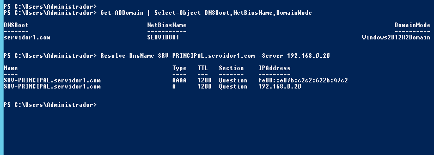
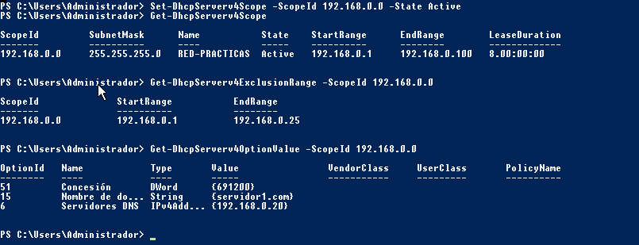
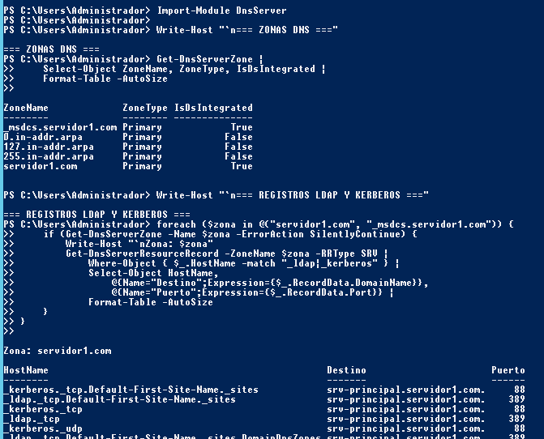
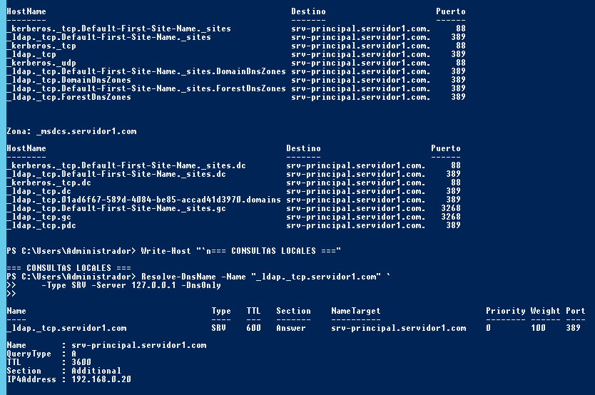
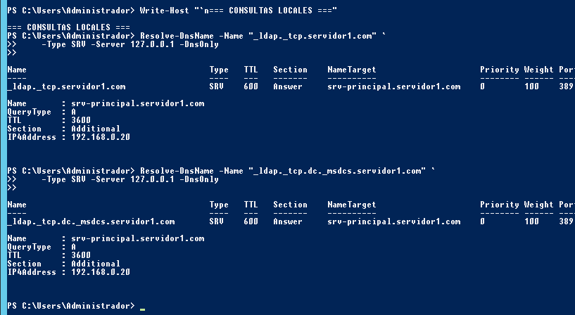
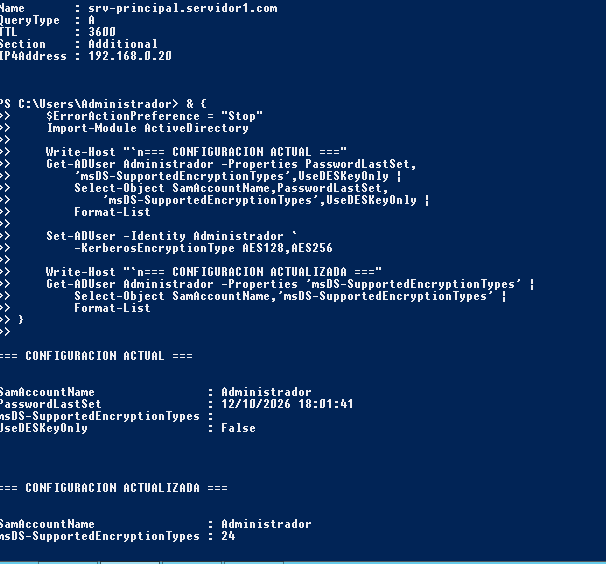

# Evidencias · 02-usuarios-dns-dhcp-gpo

[Galería completa](../README.md) · [Inicio](../../README.md)

| Captura | Archivo original |
|---|---|
| [02 dominio dns](02-dominio-dns.png) | `image(20261013-173549).png` |
| [03 dhcp](03-dhcp.png) | `image(20261013-183431).png` |
| [04 usuarios ad](04-usuarios-ad.png) | `image(20261014-024249).png` |
| [05 gpo aplicada](05-gpo-aplicada.png) | `image(20261014-045026).png` |
| [06 fondo institucional](06-fondo-institucional.png) | `image(20261014-044542).png` |
| [07 gpo restriccion](07-gpo-restriccion.png) | `image(20261014-222631).png` |
| [19 zonas dns](19-zonas-dns.png) | `image(20261015-054553).png` |
| [20 registros srv](20-registros-srv.png) | `image(20261015-054620).png` |
| [21 ldap resolucion local](21-ldap-resolucion-local.png) | `image(20261015-054640).png` |
| [22 kerberos aes administrador](22-kerberos-aes-administrador.png) | `image(20261015-062931).png` |

