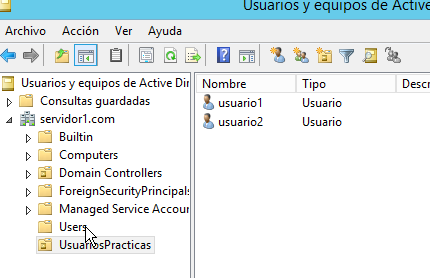
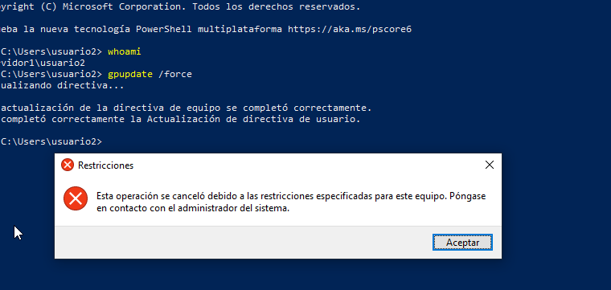
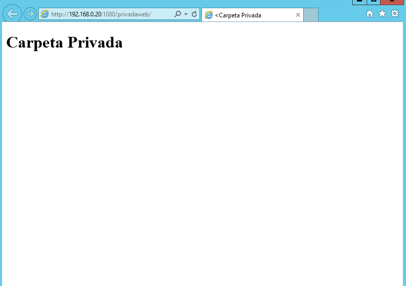
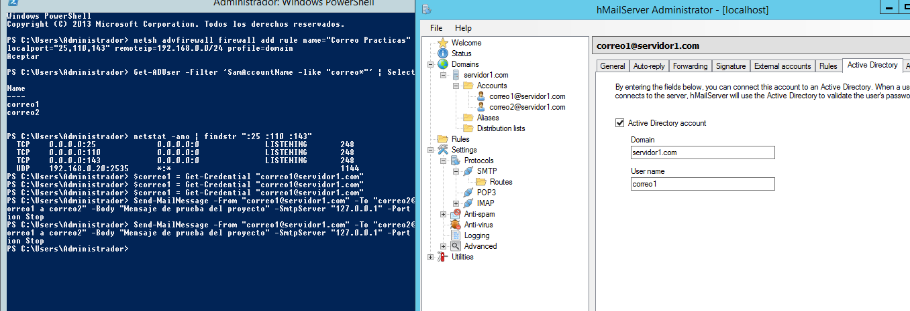
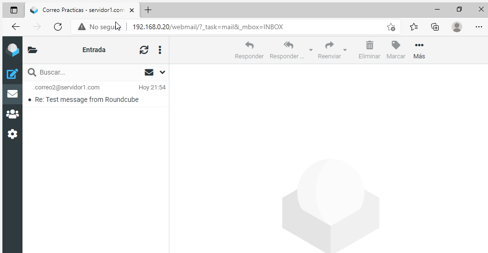

# Evidencias de la fase 1

[Inicio](../README.md) · [Manual](../docs/02-manual-fase1.md)

Selección de capturas originales proporcionadas por el equipo. Se conservaron sin retoques; se renombraron únicamente para ordenarlas. Algunas contienen intentos fallidos seguidos de su corrección, indicados en el texto. Se excluyeron pantallas de invitaciones, claves o configuraciones con secretos y capturas redundantes.

| Archivo | Captura de origen | Qué acredita |
|---|---|---|
| [Resumen de creación de SRV-PRINCIPAL](01-virtualizacion.png) | `20261012-233205` | 2 GB de RAM, 2 CPU y disco virtual de 50 GB. Es una captura del asistente inicial. |
| [Dominio y resolución DNS](02-dominio-dns.png) | `20261013-173549` | Get-ADDomain muestra servidor1.com y Resolve-DnsName devuelve 192.168.0.20. |
| [Ámbito DHCP y exclusiones](03-dhcp.png) | `20261013-183431` | Ámbito activo .1–.100; exclusión .1–.25; DNS .20 y sufijo servidor1.com. |
| [Usuarios en Active Directory](04-usuarios-ad.png) | `20261014-024249` | usuario1 y usuario2 dentro de UsuariosPracticas. |
| [Directiva aplicada en cliente Windows](05-gpo-aplicada.png) | `20261014-045026` | whoami, hostname y gpresult identifican usuario1, CLI-WINDOWS01 y GPO-Usuarios-Practicas. |
| [Fondo institucional del cliente](06-fondo-institucional.png) | `20261014-044542` | Escritorio del cliente con imagen institucional. El ajuste del tamaño puede mejorarse. |
| [Restricción del Panel de control](07-gpo-restriccion.png) | `20261014-222631` | Prueba con usuario2 después de gpupdate: Windows impide abrir la opción restringida. |
| [Permisos del recurso privado](08-carpeta-privada-permisos.png) | `20261013-232703` | La captura conserva un intento de sintaxis fallido y su corrección posterior; la salida final muestra privado con Change en SMB y Modify en NTFS. |
| [Página pública en IIS](09-web-publica.png) | `20261013-234155` | La ruta /publicweb muestra Carpeta Pública; prueba local en servidor. |
| [Página privada en puerto 1080](10-web-privada.png) | `20261014-011228` | La ruta :1080/privadaweb muestra Carpeta Privada después de autenticación. |
| [Transferencia FTP con usuario1](11-ftp-usuario1.png) | `20261014-015152` | Descarga, carga y eliminación finalizan correctamente; prueba local en servidor. |
| [Transferencia FTP con usuario2](12-ftp-usuario2.png) | `20261014-015719` | Tras un primer nombre local incorrecto, la carga corregida y la eliminación son satisfactorias; prueba local en servidor. |
| [Intervalo pasivo de FTP](13-ftp-pasivo.png) | `20261014-020032` | Configuración del intervalo 50000–50010 en IIS. |
| [FTP desde cliente Windows](14-ftp-cliente-windows.png) | `20261014-052601` | El Explorador del cliente muestra index.html en el servidor FTP. Las operaciones adicionales fueron confirmadas por el equipo. |
| [hMailServer y Active Directory](15-correo-integracion-ad.png) | `20261015-013131-1` | correo1 vinculado al usuario AD, ambas cuentas AD listadas y puertos de correo escuchando. Falta evidencia equivalente de la pestaña AD de correo2. |
| [Validación de Roundcube](16-roundcube-validacion.png) | `20261015-034022` | Configuración, escritura en temp/logs, esquema y escritura SQLite con resultado OK. Corresponde a la etapa de instalación, luego deshabilitada. |
| [Respuesta de correo2 recibida en correo1](17-correo-respuesta.png) | `20261015-035526` | Mensaje abierto en Roundcube: respuesta de correo2 a correo1. |
| [Buzón web desde cliente Windows](18-webmail-cliente.png) | `20261015-035910` | Acceso a /webmail y mensaje de respuesta recibido. La redirección /correo se comprobó adicionalmente con HTTP 302 desde Ubuntu. |
| [Zonas DNS integradas en AD](19-zonas-dns.png) | `20261015-054553` | servidor1.com y _msdcs.servidor1.com aparecen integradas en Active Directory. |
| [Registros de servicio](20-registros-srv.png) | `20261015-054620` | Registros LDAP y Kerberos en las zonas del dominio y _msdcs. |
| [Resolución local de LDAP](21-ldap-resolucion-local.png) | `20261015-054640` | Ambas consultas SRV resuelven al servidor principal y puerto 389 desde 127.0.0.1. |

## 01. Resumen de creación de SRV-PRINCIPAL

2 GB de RAM, 2 CPU y disco virtual de 50 GB. Es una captura del asistente inicial.

## 02. Dominio y resolución DNS

Get-ADDomain muestra servidor1.com y Resolve-DnsName devuelve 192.168.0.20.

## 03. Ámbito DHCP y exclusiones

Ámbito activo .1–.100; exclusión .1–.25; DNS .20 y sufijo servidor1.com.

## 04. Usuarios en Active Directory

usuario1 y usuario2 dentro de UsuariosPracticas.

## 05. Directiva aplicada en cliente Windows

whoami, hostname y gpresult identifican usuario1, CLI-WINDOWS01 y GPO-Usuarios-Practicas.

## 06. Fondo institucional del cliente

Escritorio del cliente con imagen institucional. El ajuste del tamaño puede mejorarse.

## 07. Restricción del Panel de control

Prueba con usuario2 después de gpupdate: Windows impide abrir la opción restringida.

## 08. Permisos del recurso privado

La captura conserva un intento de sintaxis fallido y su corrección posterior; la salida final muestra privado con Change en SMB y Modify en NTFS.

## 09. Página pública en IIS

La ruta /publicweb muestra Carpeta Pública; prueba local en servidor.

## 10. Página privada en puerto 1080

La ruta :1080/privadaweb muestra Carpeta Privada después de autenticación.

## 11. Transferencia FTP con usuario1

Descarga, carga y eliminación finalizan correctamente; prueba local en servidor.

## 12. Transferencia FTP con usuario2

Tras un primer nombre local incorrecto, la carga corregida y la eliminación son satisfactorias; prueba local en servidor.

## 13. Intervalo pasivo de FTP

Configuración del intervalo 50000–50010 en IIS.

## 14. FTP desde cliente Windows

El Explorador del cliente muestra index.html en el servidor FTP. Las operaciones adicionales fueron confirmadas por el equipo.

## 15. hMailServer y Active Directory

correo1 vinculado al usuario AD, ambas cuentas AD listadas y puertos de correo escuchando. Falta evidencia equivalente de la pestaña AD de correo2.

## 16. Validación de Roundcube

Configuración, escritura en temp/logs, esquema y escritura SQLite con resultado OK. Corresponde a la etapa de instalación, luego deshabilitada.

## 17. Respuesta de correo2 recibida en correo1

Mensaje abierto en Roundcube: respuesta de correo2 a correo1.

## 18. Buzón web desde cliente Windows

Acceso a /webmail y mensaje de respuesta recibido. La redirección /correo se comprobó adicionalmente con HTTP 302 desde Ubuntu.

## 19. Zonas DNS integradas en AD

servidor1.com y _msdcs.servidor1.com aparecen integradas en Active Directory.

## 20. Registros de servicio

Registros LDAP y Kerberos en las zonas del dominio y _msdcs.

## 21. Resolución local de LDAP

Ambas consultas SRV resuelven al servidor principal y puerto 389 desde 127.0.0.1.

## 22. AES habilitado para Administrador

El atributo msDS-SupportedEncryptionTypes pasa de vacío a 24; UseDESKeyOnly figura False. La captura acredita el ajuste, no una unión exitosa de Ubuntu.

